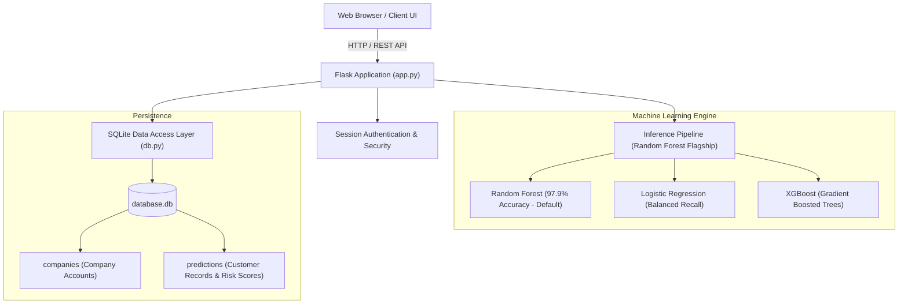

# NexIQ: Customer Churn Prediction & Retention Intelligence Platform
### Comprehensive End-to-End Technical Documentation

---

## 1. Executive Summary & Overview

**NexIQ** is an enterprise-grade, machine-learning-driven Customer Churn Prediction and Retention Intelligence platform built on **Flask**, **Scikit-Learn**, **XGBoost**, and **SQLite**. 

The system enables e-commerce and subscription businesses to:
- Proactively predict customer attrition probabilities before churn occurs.
- Automatically categorize customers into actionable tiers: **Low Risk (<30%)**, **Medium Risk (30%–70%)**, and **High Risk (>70%)**.
- Generate targeted, behavior-aligned retention playbooks (VIP outreach, win-back discounts, support intervention).
- Perform high-throughput vectorized bulk batch predictions across thousands of customer records in seconds.
- Monitor revenue at risk and customer health scores through interactive real-time analytics dashboards.

---

## 2. System Architecture



---

## 3. Machine Learning Models & Training Pipeline

### 3.1 Dataset & Feature Definition
The model suite is trained on behavioral transaction features:

| Feature Name | Type | Description |
| :--- | :---: | :--- |
| `recency` | Float | Days elapsed since the customer's last purchase. |
| `frequency` | Integer | Total number of successful orders completed. |
| `monetary` | Float | Total lifetime spending across all orders ($). |
| `average_order_value` | Float | Average order spend (`monetary / frequency`). |
| `category_diversity` | Integer | Count of unique product categories purchased. |
| `average_review_score` | Float | Average customer review rating (1.0 to 5.0). |
| `payment_count` | Integer | Cumulative payments registered across orders. |
| `delivery_delay` | Float | Days difference between actual delivery date and estimated date. |
| `inactivity_days` | Float | Days since last observed engagement. |

### 3.2 Model Performance Comparison

| Metric | Random Forest (Flagship) | Logistic Regression | XGBoost |
| :--- | :---: | :---: | :---: |
| **Accuracy** | **97.92%** | 60.55% | 75.11% |
| **Weighted F1** | **0.984** | 0.749 | 0.858 |
| **ROC-AUC** | 0.512 | **0.612** | 0.560 |
| **Training Time** | ~2.98s | **~0.14s** | ~0.76s |
| **Artifact Path** | `models/random_forest.joblib` | `models/logistic_regression.joblib` | `models/xgboost.joblib` |

### 3.3 Target Definition & Risk Tier Thresholds
- **Outcome Target**: `churn = 1` (Customer had no repeat purchase in future observation window); `churn = 0` (Retained).
- **Risk Score Tiers**:
  - **Low Risk**: `Probability < 0.30` (Health Score: `70 - 100`)
  - **Medium Risk**: `0.30 <= Probability <= 0.70` (Health Score: `30 - 69`)
  - **High Risk**: `Probability > 0.70` (Health Score: `0 - 29`)

---

## 4. Database Schema (SQLite)

### Table: `companies`
Stores multi-tenant account credentials.
```sql
CREATE TABLE IF NOT EXISTS companies (
    id INTEGER PRIMARY KEY AUTOINCREMENT,
    company_name TEXT NOT NULL,
    email TEXT UNIQUE NOT NULL,
    password_hash TEXT NOT NULL,
    created_at TIMESTAMP DEFAULT CURRENT_TIMESTAMP
);
```

### Table: `predictions`
Stores all individual and bulk prediction outcomes.
```sql
CREATE TABLE IF NOT EXISTS predictions (
    id INTEGER PRIMARY KEY AUTOINCREMENT,
    company_id INTEGER NOT NULL,
    customer_id TEXT NOT NULL,
    recency REAL,
    frequency REAL,
    monetary REAL,
    average_order_value REAL,
    category_diversity REAL,
    average_review_score REAL,
    payment_count REAL,
    delivery_delay REAL,
    inactivity_days REAL,
    prediction INTEGER,
    probability REAL,
    risk_level TEXT,
    batch_id TEXT,
    source_file TEXT,
    upload_mode TEXT DEFAULT 'single',
    health_score REAL,
    recommendation TEXT,
    created_at TIMESTAMP DEFAULT CURRENT_TIMESTAMP,
    FOREIGN KEY(company_id) REFERENCES companies(id)
);
```

---

## 5. API Reference & Endpoints

### 5.1 Single Prediction
- **URL**: `/predict`
- **Method**: `POST`
- **Auth**: Required (`login_required`)
- **Headers**: `Content-Type: application/json`
- **Request Body**:
```json
{
  "recency": 42.0,
  "frequency": 3.0,
  "monetary": 320.5,
  "average_order_value": 106.83,
  "category_diversity": 2.0,
  "average_review_score": 4.5,
  "payment_count": 3.0,
  "delivery_delay": 0.0,
  "inactivity_days": 42.0
}
```
- **Response (`200 OK`)**:
```json
{
  "customer_id": "CUST_FF72FEA7",
  "health_score": 21.7,
  "insight": "High churn risk detected (78% probability) based on order cadence and spending trends.",
  "model_used": "random_forest",
  "outcome_label": "Churned",
  "prediction": 1,
  "probability": 0.783,
  "probability_retained": 0.217,
  "recommended_action": [
    "Deploy automated churn-prevention offer",
    "Engage customer via personalized notification"
  ],
  "risk_level": "High"
}
```

### 5.2 Bulk Batch Upload
- **URL**: `/bulk-upload`
- **Method**: `POST`
- **Auth**: Required
- **Form Data**: `file` (`.csv` or `.xlsx`)
- **Response (`200 OK`)**:
```json
{
  "message": "Batch processed successfully",
  "batch_id": "BATCH_9F9F465D",
  "filename": "bulk_upload_sample_500.csv",
  "total_rows": 600,
  "valid_rows": 600,
  "invalid_rows": 0,
  "high_risk_count": 200,
  "medium_risk_count": 200,
  "low_risk_count": 200,
  "average_probability": 0.521,
  "revenue_at_risk": 52400.00
}
```

### 5.3 Dashboard Metrics
- **URL**: `/api/dashboard-data`
- **Method**: `GET`
- **Auth**: Required
- **Response**: Aggregated summary (`total_predictions`, `high_risk_count`, `revenue_at_risk`, `avg_risk_probability`, and recent customer records).

### 5.4 Export Predictions
- **URL**: `/export` or `/export-batch/<batch_id>`
- **Method**: `GET`
- **Response**: Downloadable `.csv` file attachment.

---

## 6. Directory Structure

```
churn-predict-main/
│
├── app.py                             # Core Flask application, routing & inference logic
├── db.py                              # Database models, connection pool & batch executemany
├── data_pipeline.py                   # Data cleaning, temporal cutoff & leakage-free feature engineering
├── train_model.py                     # Multi-model training, evaluation & serialization script
│
├── models/                            # Trained Serialized Scikit-learn Pipelines
│   ├── random_forest.joblib           # Flagship high-accuracy Random Forest pipeline
│   ├── logistic_regression.joblib     # Balanced Logistic Regression pipeline
│   └── xgboost.joblib                 # Gradient-boosted trees pipeline
│
├── static/
│   ├── css/style.css                  # Custom responsive dark-mode styling system
│   ├── js/main.js                     # Frontend state management, charts & side-panel modals
│   └── images/                        # UI background assets
│
├── templates/
│   ├── base.html                      # Global shell navigation & footer
│   ├── index.html                     # Marketing landing page
│   ├── login.html / register.html     # Authentication views
│   ├── predict.html                   # Single risk prediction engine
│   ├── bulk_upload.html               # Batch CSV/XLSX processing portal
│   ├── dashboard.html                 # Executive KPIs, Chart.js graphs & customer table
│   └── models_comparison.html         # ML performance evaluation matrix
│
├── bulk_upload_sample_500.csv         # Balanced 600-row testing dataset (Low, Med, High)
├── balanced_churn_sample_600.csv      # Verification dataset with clean probability clusters
├── model_metrics.json                 # Machine-readable evaluation report
├── requirements.txt                   # Production dependencies (including gunicorn)
├── .gitignore                         # Production ignore file (venv, caches, logs)
└── .env.example                       # Environment variable template
```

---

## 7. Running Locally

### Prerequisites
- Python 3.10+ (Python 3.11 recommended)
- `pip` package manager

### Steps
1. **Clone the Repository**:
   ```bash
   git clone https://github.com/swarabytes/customer-churn-prediction.git
   cd customer-churn-prediction
   ```

2. **Create & Activate Virtual Environment**:
   ```bash
   python -m venv venv
   # Windows (PowerShell):
   .\venv\Scripts\Activate.ps1
   # macOS / Linux:
   source venv/bin/activate
   ```

3. **Install Dependencies**:
   ```bash
   pip install -r requirements.txt
   ```

4. **Launch Application**:
   ```bash
   python app.py
   ```
   Open **http://127.0.0.1:5000** in your browser.

5. **Default Credentials**:
   - Register a new account at `/register`, or use the built-in legacy admin:
     - **Email**: `admin@legacy.com`
     - **Password**: `legacy_admin_secret_change_me!`

---

## 8. Deployment on Render

The repository is configured for one-click deployment on **Render**:

1. **New Web Service**: Connect your GitHub repository: `https://github.com/swarabytes/customer-churn-prediction`.
2. **Environment**: Python 3
3. **Build Command**:
   ```bash
   pip install -r requirements.txt
   ```
4. **Start Command**:
   ```bash
   gunicorn app:app
   ```
5. **Environment Variables**:
   - `SECRET_KEY` = `your_secure_random_key_here`
   - `PYTHON_VERSION` = `3.11.9`
6. Click **Deploy Web Service**.
